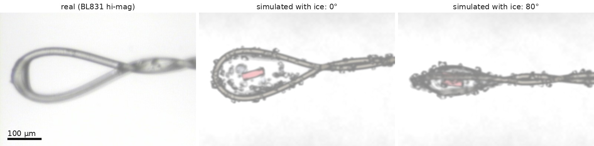

# jacob_run — James's hi-mag scenes on Jacob's renderer and camera server

Scripts for running James's digitized hi-mag loop (`../hoop.yaml`, from
[`real_loop_himag.jpg`](../real_loop_himag.jpg)) through Jacob Doughty's xtal-loop-sim
(`/home/jadoughty/projects/loop_sim_MINE/xtal-loop-sim`, branch
`performance-correctness-optimizations`).  Jacob's repo is read-only for
jamesh and is never modified: everything here either generates input for it or
wraps it at runtime.



*Left: [`real_loop_himag.jpg`](../real_loop_himag.jpg), the BL831 hi-mag photo the hoop was digitized
from (no ice).  Middle and right: the same loop simulated as
`james_himag_rod60_ice2`, at 0° and 80°.  It has a 60 × 20 µm crystal and a
52 µm drop, plus 180 ice flecks from `add_ice.py` (120 on the nylon, 60 on the
drop faces).  Rendered by Jacob's tracer, then blurred and camera-matched to
the photo by `postprocess.py`.*

The scripts live here in git.  The work directory
`/home/jamesh/projects/loop_sim/jacob_run/` holds the generated output (scene
files, frame libraries, renders) and symlinks back to these scripts.  The paths
are absolute on purpose.

| file | what it does |
|---|---|
| `make_scene.py` | Builds a hi-mag scene with the true BL831 pixel aspect, then runs `add_stem` / `add_droplet` / `add_crystal`.  Options: `--preset/--dim/--c-tilt` (crystal), `--drop-half-thickness` (Young–Laplace drop), `--nylon-mu`. |
| `add_ice.py` | Adds frost flecks (convex ice grains) to an existing scene, on the nylon (`--n`) and on the drop faces (`--n-drop`). |
| `oneshot.slurm` | Renders one scene at 0°, 80° and 90° on voltron.  `sbatch --export=ALL,NAME=<stem> oneshot.slurm` |
| `postprocess.py` | Applies a 2.3 µm blur and the camera fit to `real_loop_himag.jpg`, then writes the 2×2 panel (0° \| photo / 80° \| 90°). |
| `camera_fit.npy` | Camera fit to the photo: E, F, vignette amplitude = 0.996, 0.543, 0.288. |
| `build_library.slurm` | Builds the 360-frame library the camera server plays back.  `sbatch --export=ALL,NAME=<stem> build_library.slurm` |
| `serve.py` | Launches Jacob's camera server with two runtime fixes (see the docstring): the UI page from `static/`, and correct vertical motion for James's scenes. |
| `static/index.html` | Jacob's UI page; the control panel stays to the right of the video at any width. |

## Recipes

Run the generators from the work directory with the PyTorch env.  Run the
renderer and server from Jacob's repo with his venv.

```bash
cd /home/jamesh/projects/loop_sim/jacob_run
P=/programs/pytorch/envs/pt/bin/python

# 60 x 20 um rod, 52 um drop, absorbing nylon (used for Fig. TOC3-5)
$P make_scene.py --name james_himag_rod60 --preset needle --dim 0.010 0.030 \
    --c-tilt 15 10 --drop-half-thickness 0.0524 --nylon-mu 20
# plus frost: 120 flecks on the nylon, 60 on the drop
$P add_ice.py scene_files/james_himag_rod60.yaml james_himag_rod60_ice2 \
    --n 120 --n-drop 60 --size 0.008 0.025

sbatch --export=ALL,NAME=james_himag_rod60 oneshot.slurm          # ~3 min
cd /home/jadoughty/projects/loop_sim_MINE/xtal-loop-sim && env PYTHONPATH=. \
    .venv/bin/python /home/jamesh/projects/loop_sim/jacob_run/postprocess.py rod60
```

### Serving a scene live

1. Build its library: `sbatch --export=ALL,NAME=<stem> build_library.slurm`.
2. Add it to the served list:
   `ln -s ../scene_files/<stem>.yaml served_scenes/`.
   Only link scenes that have a built library.  Every file in `--scene-dir`
   becomes a tab, and too many tabs push the control panel under the video.
3. Start the server detached, so it outlives the shell (don't `pkill -f` a
   pattern that also matches your own shell):

```bash
cd /home/jadoughty/projects/loop_sim_MINE/xtal-loop-sim && setsid nohup \
  .venv/bin/python /home/jamesh/projects/loop_sim/jacob_run/serve.py \
  --scene /home/jamesh/projects/loop_sim/jacob_run/served_scenes/james_himag_rod60_ice2.yaml \
  --scene-dir /home/jamesh/projects/loop_sim/jacob_run/served_scenes \
  --library-root /home/jamesh/projects/loop_sim/jacob_run/frame_library \
  --preview-root /home/jamesh/projects/loop_sim/jacob_run/frame_library_preview \
  --port 8081 > /home/jamesh/projects/loop_sim/jacob_run/server.log 2>&1 < /dev/null &
```

Open http://bl831:8081.  The photo pose is
`POST /motor?tx=0.076732&ty=-0.039846&tz=0&rotx=0`.

## Numbers worth knowing

- BL831 hi-mag pixels are 0.8233 (h) × 0.9139 (v) µm.  Scenes render on a
  square 634×480 grid at 0.9139 µm, which the server resamples to the 704×480
  sensor (field of view 579 × 439 µm).  The hoop's digitized y values are
  scaled by 1.110.
- Library builds: `--supersample 1 --pan-mm 0.2`.  The defaults are sized for
  the 7.4 µm mid-mag scenes and give ~100 Mpx frames here.  A frame takes about
  6 s; 360 frames take about 35 min.
- Ice is slow: each fleck is a separate object.  `rod60_ice2` (180 flecks)
  took 168 s per frame, so its library took 17 h.
- The "stale" badge on James's libraries only means `pan_mm` differs from the
  default; they still serve.
- The live server shows Jacob's default camera response with no blur, so it
  looks darker and sharper than `postprocess.py` output.
